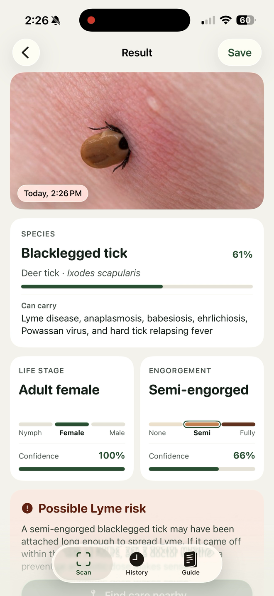
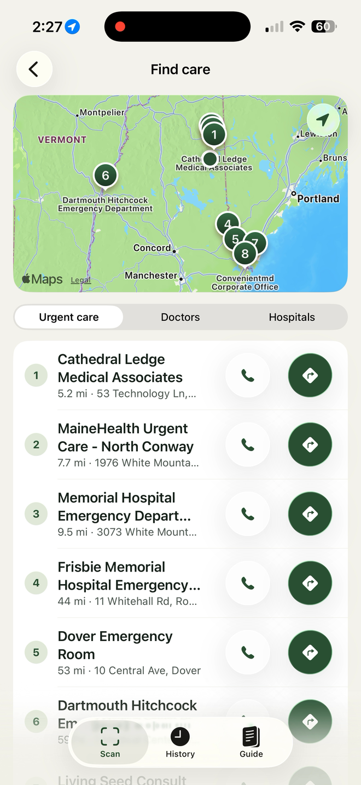
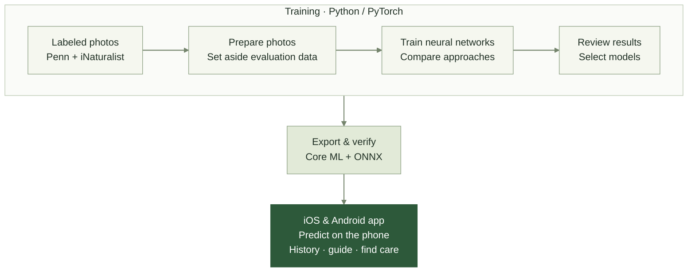

# TickPredict: Tick identification on your phone.

## Installation

Clone the project:

```sh
git clone https://github.com/EliseBuehler2000/tickpredict.git
cd tickpredict
```

The models are included in the repository. No training or model download is needed after cloning.

### iOS

Installation requires a Mac with Xcode and an iPhone or simulator running iOS 26 or later.

1) Open `ios/TickPredict.xcodeproj` in Xcode.
2) Select the TickPredict target and choose your team under **Signing & Capabilities**.
3) For a physical iPhone, connect it to the Mac and enable **Developer Mode** in **Settings → Privacy & Security**.
4) Select your iPhone or an iPhone simulator as the build destination, then click **Run** to install the app.

### Android

1) Install Android Studio with Android SDK 35 and JDK 17 or later. Android Studio's bundled JDK works.
2) Open `android/` in Android Studio and let Gradle sync.
3) Connect a phone running Android 10 or later with **USB debugging** enabled, or start an emulator.
4) Select the device and click **Run** to install the app.

Build commands and platform details: [iOS](ios/README.md) · [Android](android/README.md).

**Abstract**:

Can a photo help someone understand a tick they have found? TickPredict uses neural networks to estimate a tick's species, life stage, and engorgement directly on a phone. The models learn from University of Pennsylvania research photos and iNaturalist field photos, then run locally through Core ML on iOS and ONNX Runtime on Android. The app recognizes eight U.S. tick species and brings the predictions together with tick removal guidance, a saved scan history, and a nearby care search. Photo analysis works offline, with no account or server, and photos stay on the device. Finding nearby care uses online map services.

<p align="center">
  
  
  <br />
  <sub>Tick analysis and nearby care on iOS.</sub>
</p>

## Structure

- `ios/`: Swift/SwiftUI app with Core ML inference.
- `android/`: Kotlin/Jetpack Compose app with ONNX Runtime inference.
- `scripts/` and `configs/`: Python/PyTorch training, evaluation, and mobile export.
- `models/`: versioned model metadata and Core ML exports; Android exports are in `android/app/src/main/assets/models/`.

Both apps share the same Scan, History, Guide, and Find care flows.

## Training and app pipeline



- Training compares models on development photos while keeping the protected test sets untouched.
- The apps use v2's ConvNeXt Tiny model for species and life stage, and v1's EfficientNet V2 S model for engorgement.
- Mobile exports include averaging across eight rotated or reflected views. Checks compare the mobile predictions with Python.

| Prediction | Development accuracy | Photos |
|---|---:|---|
| Species | 85.05% (1,109/1,304) | iNaturalist |
| Life stage | 93.07% (913/981) | iNaturalist |
| Life stage | 96.36% (106/110) | Penn |
| Engorgement | 86.36% (95/110) | Penn |

These results were used for model selection, not independent testing. Confidence scores are uncalibrated; the models cannot reject non-tick images or unsupported species. TickPredict is a research prototype, not a diagnosis.

See the [v1 training guide](docs/training.md), [v2 training code](scripts/multihead_experiment.py), and [v2 release record](models/v2.0/manifest.json) for methods and results.
