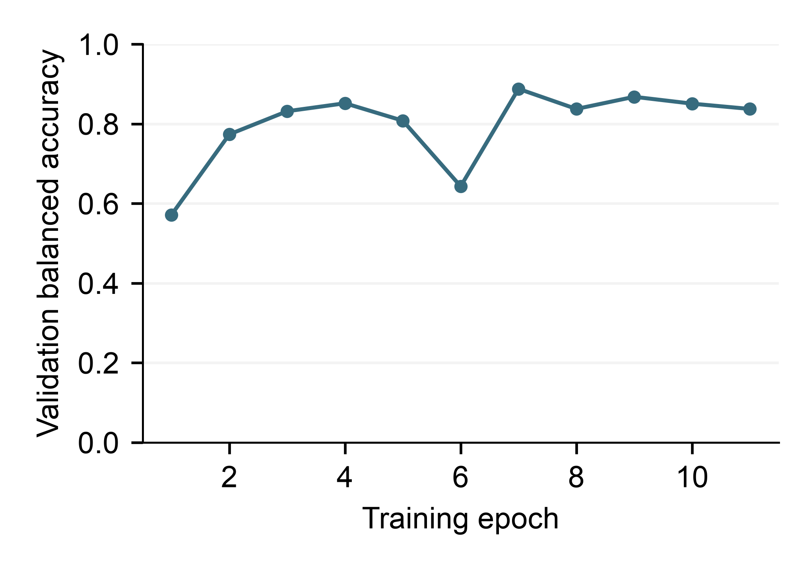

# TickPredict — life stage results

Completed research baseline on Penn validation images.

Run: 20261013-125510-220265_life_stage. Supported labels: adult female, nymph.

| Result | Value |
|---|---:|
| Correct predictions | 100 of 110 |
| Overall accuracy | 90.91% |
| Balanced accuracy | 88.76% |
| Best saved epoch | 7 |
| Total epochs run | 11 |
| Protected test images used (recorded provenance) | 0 |

## Confusion matrix

Rows are recorded labels; columns are model predictions. Balanced accuracy is the mean of the per-class recalls below.

| Recorded label | Predicted adult female | Predicted nymph | Recall |
|---|---:|---:|---:|
| adult female | 29 | 6 | 29/35 = 82.86% |
| nymph | 4 | 71 | 71/75 = 94.67% |

The model made 10 errors among 110 validation observations.

## Learning history

The saved model was selected at epoch 7 using validation balanced accuracy. Training ran for 11 epochs. The same validation observations were reused across epochs.

## Individual errors

| Tick ID | Recorded label | Model prediction |
|---|---|---|
| 283122 | adult female | nymph |
| 284606 | adult female | nymph |
| 285562 | adult female | nymph |
| 286236 | adult female | nymph |
| 287120 | nymph | adult female |
| 287553 | adult female | nymph |
| 287679 | nymph | adult female |
| 287996 | adult female | nymph |
| 289267 | nymph | adult female |
| 289797 | nymph | adult female |

## Interpretation

These validation observations were used for checkpoint selection, so these figures are not independent test results. They describe life stage classification for the listed labels in this Penn cohort. These saved results do not evaluate smartphone photographs, unsupported classes, or human Lyme risk. Softmax model scores are uncalibrated and must not be read as validated probabilities of correctness. Person-level separation cannot be checked because person identifiers are unavailable.

The run provenance records 0 protected test images used. Generating this report reads saved JSON only and performs no model evaluation.

## Saved files

- best.pt: selected model checkpoint.
- validation.json: confusion matrix, recorded labels, predictions and uncalibrated model scores.
- history.json: results for each training epoch.
- provenance.json: cohort fingerprints, classes, software versions and configuration.
- completion.json: completion status and best recorded validation score.

This report was generated from the saved run; its checkpoints and JSON records were left unchanged.
